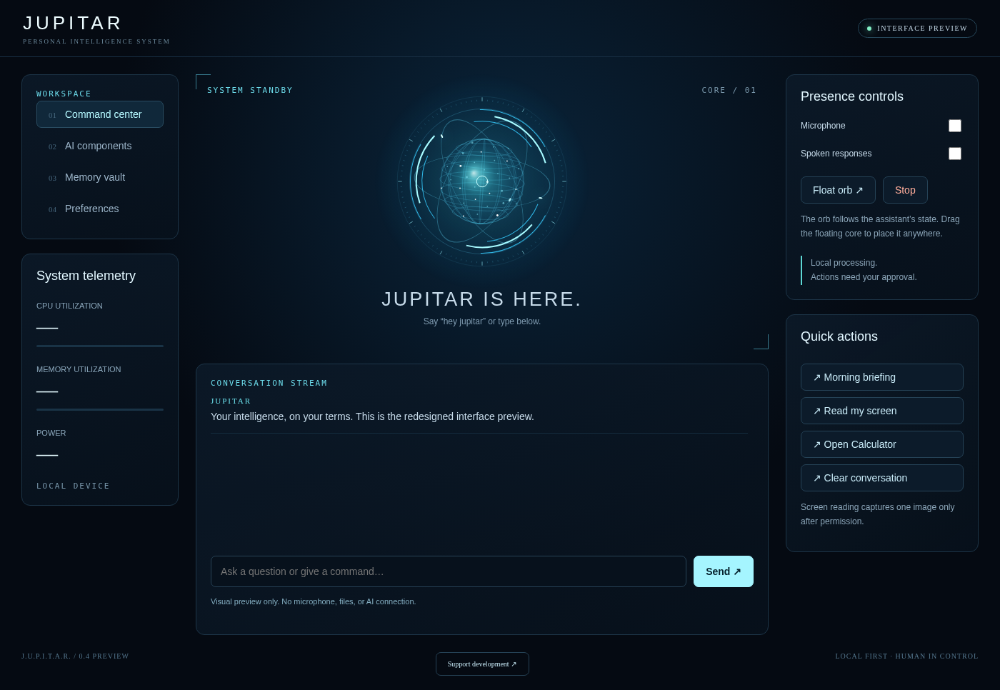

# J.U.P.I.T.A.R. / Orbital Edition 0.4 preview
## Just-in-time Unified Personal Intelligence for Tasks, Automation & Reasoning

Original cinematic command center, a transparent floating orbital core, measured
AI download progress, and a matching public website. Source/build package only:
no compiled EXE or hosted site is included. Windows integration is untested.

## What changed from 0.3
- Replaced the Tkinter frontend with a Qt WebEngine HTML/CSS/Canvas interface.
- Luminous mesh core, independent orbital paths, satellites, layered rings and
  real microphone-energy response. State labels reflect actual backend state.
- Separate frameless, transparent, always-on-top orb window with native drag,
  open/mute/hide controls. Windows transparency/drag still needs device testing.
- Measured aggregate download percentage, bytes/total, rolling speed and ETA.
  Pause/resume uses HTTP Range when supported. Verification is a separate stage.
- Static premium website with the same orbital renderer, actual frontend preview,
  capability/limitations sections, setup explanation, FAQ and support link.
- Website checks public GitHub Releases for a real installer asset. No fake
  download button or hardcoded claim that a build is available.
- GitHub Pages workflow and optional DRAFT prerelease creation after successful build.

## Use the update
Read START HERE.txt and docs/UPDATE_AND_PUBLISH.md. Upload the extracted project
contents into the existing repository, preserving the root layout and workflows.
A successful Windows workflow produces the unsigned test installer. Enable Pages
with GitHub Actions to publish site/. Publish a tested installer as a Release to
activate public downloads. No account changes were made by this package.

## Preview without installing anything
Open ui/index.html in a browser for the visual-only desktop preview. Open
site/index.html for the website. Browser previews cannot access the microphone,
files or local AI. Preview fonts fall back if Rajdhani is absent; build workflows
download Rajdhani and its original license before packaging/deployment.

## Existing backend
App-managed local llama.cpp engine, local Whisper speech recognition, installed
Windows SAPI voice output, approved memory, reminders, bounded tools/plans and
consented one-shot screen analysis. No separate Python/Ollama installation for
users of a successful compiled build. Models download explicitly on first launch.

## Honest boundaries
58 isolated tests and browser UI tests passed; see TEST_REPORT.md. No Windows
installer, Qt native bridge, native orb, actual model transfer, inference, audio,
16 GB performance, code signing or Store certification was validated here.
Natural neural Gujarati TTS, universal desktop automation and robust echo
cancellation remain unfinished. Qt WebEngine increases package size and RAM use;
16 GB is a target, not a measured guarantee. This is not movie-equivalent AI.

## License and support
Original code remains MIT, Uootsav. Review all Qt/PySide, Chromium, model, font
and dependency terms before redistribution/sale. Notices collection is not a
complete legal audit. Name/trademark clearance has not been performed.

[Support development](https://paypal.me/Uootsav)
